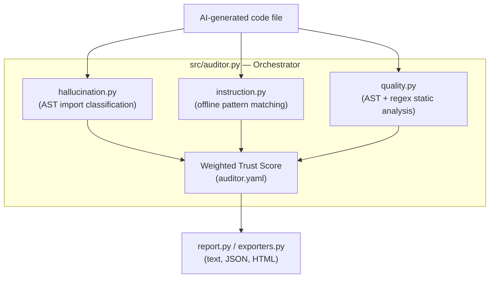

# KYRION — AI Auditor

**Unified verification for AI-generated code.** KYRION audits code produced by LLMs along three independent axes — hallucinated imports, instruction adherence, and code quality — and combines them into a single, configurable Trust Score. The repo is both a standalone CLI tool and the full reproducibility package for the accompanying paper, which benchmarks five LLMs' code generation against that score.

---

## Table of Contents

1. [What KYRION Checks](#what-kyrion-checks)
2. [Architecture](#architecture)
3. [CLI Usage](#cli-usage)
4. [Installation](#installation)
5. [Research Reproducibility Pipeline](#research-reproducibility-pipeline)
6. [Project Structure](#project-structure)
7. [Configuration](#configuration)
8. [Testing](#testing)
9. [Security Notes](#security-notes)
10. [License](#license)

---

## What KYRION Checks

| Phase | Module | What it does |
|-------|--------|----------------|
| Hallucination detection | `src/hallucination.py` | Parses code into an AST and classifies every imported module as a **true hallucination** (not in the standard library or resolvable to a real PyPI package), an **unused import**, or **resolved/OK**. |
| Instruction adherence | `src/instruction.py` | Checks whether generated code follows custom instructions using offline pattern matching — no API key or network call required. |
| Code quality | `src/quality.py` | AST-based structural checks (unused imports, dead/unreachable code, long functions, missing docstrings, mutable default arguments) plus textual checks for hardcoded secrets, weak crypto, `eval`/`exec`, and shell calls. |

These three sub-scores combine into a single **Trust Score**:

```
trust = (w_h * hallucination_sub + w_i * instruction_sub + w_q * quality_sub)
        / (w_h + w_i + w_q)
```

Weights are configurable in [`auditor.yaml`](auditor.yaml) (equal thirds by default) and auto-renormalize when a phase isn't available for a given sample (e.g. no prompt/instructions supplied).

---

## Architecture



The same three detectors power both the `cli.py` single-file tool and the batch `run_evaluation.py` pipeline used for the paper's dataset.

---

## CLI Usage

```bash
python3 cli.py path/to/generated_code.py
python3 cli.py path/to/generated_code.py --prompt "Write a function that..." -i "must use type hints" "no global state"
python3 cli.py path/to/generated_code.py --format json
python3 cli.py path/to/generated_code.py --format html > report.html
```

Output includes a per-phase breakdown, the combined Trust Score, and a total issue count; the process exits non-zero if any issues were found, so it can be used as a CI gate.

---

## Installation

```bash
git clone https://github.com/kasmya/KYRION.git
cd KYRION
pip install -r requirements.txt
```

`requirements.txt` covers the CLI and research pipeline. `pyproject.toml` describes the installable `ai-auditor` package for Poetry-based workflows.

---

## Research Reproducibility Pipeline

The paper's results are produced from samples already checked into the repo (five models × twenty tasks, multiple repetitions each under [`research/samples/`](research/samples)) — no API calls are required to reproduce the published numbers.

```bash
bash reproduce.sh
```

This runs, in order:
1. Install pinned dependencies
2. Run the detector test suite (`pytest tests/`) — must pass before any score is trusted
3. Audit every sample → `research/data/results.csv` and `results_runs.csv` (`run_evaluation.py`)
4. Run the Trust Score weight-sensitivity sweep (`weight_sensitivity.py`)
5. Validate the hallucination detector against labelled ground truth (`validate_detector.py`)
6. Run the per-model comparison analysis (`research/analysis/compare_models.py`)

### Generating new samples

Model code generation (via NVIDIA NIM) is a separate, optional step — not required to reproduce the paper, only to extend the dataset with new models:

```bash
export NVIDIA_KEY_DEEPSEEK_PRO=...
export NVIDIA_KEY_QWEN35=...
export NVIDIA_KEY_NEMOTRON_ULTRA=...
export NVIDIA_KEY_GPTOSS=...
python3 humaneval_completions.py
```

`api_config.py` reads every key from an environment variable with **no literal fallback** — it raises a clear error if a key is missing rather than silently using a hardcoded value. Never commit real keys into this file.

### Supplementary analysis phases

Phases 2–7b (`phase2_smell_breakdown.py` … `phase7b_failure_oracle.py`) and the `step1_*`–`step3_*`/`validate_*`/`stylistic_*` scripts are additional analyses written in response to specific reviewer questions (smell-type breakdown, claims-to-evidence traceability, multiple-comparisons correction, parse-failure attribution, etc.). Each file's module docstring explains which question it answers; run them individually once the core `reproduce.sh` pipeline has produced `research/data/results*.csv`.

---

## Project Structure

```
KYRION/
├── cli.py                     # Single-file CLI entrypoint
├── src/                        # Core detectors (hallucination, instruction, quality, auditor, report, exporters)
├── tests/                      # Detector unit tests
├── examples/                   # Sample good/bad AI-generated code for manual testing
├── auditor.yaml                # Trust Score weights & quality-penalty config
├── requirements.txt / pyproject.toml
│
├── research/
│   ├── samples/                 # research/samples/<model>/task<NN>/run<K>.py — the benchmark corpus
│   ├── data/                    # Generated CSVs (results, stats, smell breakdowns)
│   └── analysis/                # compare_models.py, graphs.py, analyze.py
├── dataset_outputs/              # Raw per-task model outputs as originally collected
├── _excluded_models/             # Models excluded from the final dataset (kept for transparency)
├── _excluded_parsefail/          # Samples that failed to parse, quarantined rather than silently dropped
│
├── run_evaluation.py             # Batch-audits every sample -> results.csv / results_runs.csv
├── weight_sensitivity.py         # Trust Score weight-sensitivity sweep
├── validate_detector.py / validate_v2.py   # Hallucination detector precision/recall validation
├── stats_analysis.py / stylistic_friedman.py / stylistic_task_level_recomputed.csv
├── phase2_smell_breakdown.py … phase7b_failure_oracle.py   # Reviewer-response analyses
├── step1_import_dataset.py … step3_quality_gate.py          # Dataset intake / QA scripts
├── humaneval_completions.py       # Optional: generate + audit HumanEval completions
├── api_config.py                  # NVIDIA NIM key config (env-vars only, no secrets committed)
├── reproduce.sh                   # End-to-end reproduction of every paper result
│
├── generate_paper_figures.ipynb / generate_paper_figures_v4.ipynb
├── paper_figures/                 # Exported figure PNGs + notebook
├── paper/                         # IEEE submission PDFs
└── README.md
```

---

## Configuration

`auditor.yaml` controls the Trust Score:

```yaml
trust_score_weights:
  hallucination: 0.3333
  instruction:   0.3333
  quality:       0.3334

hallucination_penalty: 25

quality_penalties:
  security:  15
  dead_code: 5
  code_smell: 3
```

Changing these weights and re-running `weight_sensitivity.py` reproduces the paper's robustness analysis.

---

## Testing

```bash
pytest tests/
```

Covers the hallucination detector, instruction-adherence checker, quality analyzer, and the weighted-average logic in `auditor.py`.

---

## Security Notes

- `api_config.py` never contains literal API keys — only `os.environ.get(...)`-style reads with no fallback string. Supply keys via environment variables or a local, gitignored `.env` file.
- This repo's git history previously contained hardcoded NVIDIA API keys; they have been redacted from history and the exposed keys have been rotated. If you fork or mirror this repo from an old copy, do not reuse any key you find in old commits.

---

## License

MIT — see [LICENSE](LICENSE).
